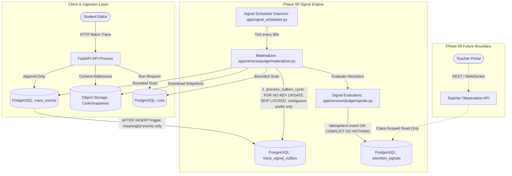

# 33 — ATTENTION SIGNAL ARCHITECTURE & PHASE 08 SPECIFICATION

> **Module:** Attention Signal Engine (Phase 08)  
> **Status:** LOCKED — `phase-08-signal-locked` (`a74e5d1`); GAP-08D-03 ratified 2026-10-28 (DCR SPNC_IDLE_HISTORICAL_GAP_CONTRACT)  
> **Date:** 2026-10-23  
> **Branch:** `phase08`  
> **Parent Baseline:** `phase-07-judge-locked` (`d44f25d88c8bba180482460f0bcff91fac8f9a83`)  
> **Target Lock Tag:** `phase-08-signal-locked`  

---

## 1. Executive Summary & Baseline State

Phase 08 establishes the autonomous backend **Attention Signal Engine** of the SPNC platform. In alignment with `docs/PROJECT_RULES.md` (Rules #20–22) and `docs/00_SCOPE.md` (Goal G5, Non-Goals NG1–NG2), the system acts strictly as an objective observer that detects observable behavioural phenomena and materializes immutable, verifiable evidence for teachers. The system **never** infers intent, evaluates student cognitive state, or labels student conduct.

### 1.1 Status of Preceding Sub-Phases
- **Phase 08A (Domain & Data Schema):** Implemented (uncommitted candidate). Alembic revision `51377aaa532a` introduces `dedup_key` (String(255), unique, indexed) to the `attention_signals` table. Model `AttentionSignal` defines exact fields; `teacher_note` is structurally omitted in accordance with invariant `DBI-015` and `docs/01_DOMAIN.md` §1.8.
- **Phase 08B (Signal Heuristic Algorithms):** Implemented (uncommitted candidate). Core evaluators in `apps/api/app/services/judge/signals.py` evaluate four authorized signal types strictly from historical `TraceEvent`, `Run`, and `CodeSnapshot` records. `ScratchpadRevision` is strictly excluded.
- **Phase 08C (Scheduler & Materializer):** Implemented (uncommitted candidate). Polling entrypoint `apps/api/app/signal_scheduler.py` and batch materializer `apps/api/app/services/judge/materializer.py` provide bounded candidate scanning, error isolation, and PostgreSQL dialect `ON CONFLICT (dedup_key) DO NOTHING` idempotency.
- **Phase 08 Verification State:** Verified in isolated QA execution (`spnc-postgres-phase08-qa` on PostgreSQL 16.15), passing 45 automated unit, algorithm, cycle, and concurrency tests.
- **Phase 08D (Integration & Hardening):** Implemented (uncommitted candidate, 2026-10-28). Adds Alembic revision `c4819d7a2e10` (`trace_signal_outbox` table + `AFTER INSERT` trigger on `trace_events` + idempotent historical bootstrap), `process_outbox_cycle` in the materializer, `evaluate_historical_idle_gaps` in the evaluators, interruptible scheduler shutdown, non-null `rule_version` on all four evaluators, and canonical §1.8 evidence keys alongside legacy diagnostic keys. See §15 for the 08D change log.
- **Independent Review Finding:** Independent review of the initial Phase 08D specification returned `FAIL` due to misattribution of `REQ-SIGNAL-001`, unpopulated `rule_version` entity column, missing `meaningful_event_before_id` in `IDLE_DETECTED` evidence, and unhandled historical inter-event gaps. This remediated specification formalizes the architectural baseline, functional gaps, and closure prerequisites.

---

## 2. Phase 08D Scope and Boundaries

### 2.1 Authorized Phase 08D Scope
Phase 08D is strictly an **integration, operational hardening, and baseline verification** phase:
1. **Interruptible Graceful Scheduler Lifecycle:** Upgrade `apps/api/app/signal_scheduler.py` with an interruptible wait mechanism (`threading.Event`) and OS signal handling (`SIGINT`, `SIGTERM`, Windows console control) to ensure running cycles finish safely or rollback cleanly without delay or leaked database connections.
2. **Signal Remediation:** Remediate `apps/api/app/services/judge/signals.py` to populate non-null `AttentionSignal.rule_version` and include `meaningful_event_before_id` in `IDLE_DETECTED` evidence.
3. **Unified End-to-End Integration Suite:** Implement `apps/api/tests/judge/test_signals_e2e.py` validating all 4 signal types across complete student practice session lifecycles on a real PostgreSQL instance.
4. **Architecture & Gap Traceability:** Formally lock the architectural contract and functional gap matrix via this document (`docs/33_ATTENTION_SIGNAL_ARCHITECTURE.md`).
5. **Phase Baseline Closure:** Perform clean candidate verification on fresh PostgreSQL, execute repository hygiene (cleanup of temporary helper scripts and detached secondary worktrees), commit the verified Phase 08 candidate, and anchor Git tag `phase-08-signal-locked`.

### 2.2 Explicit Exclusions (Strict Scope Fencing)
The following elements are strictly forbidden in Phase 08 and Phase 08D:
- **No Teacher Observation REST Endpoints:** Endpoints retrieving student observation lists, session timelines, code snapshot comparisons, and exam monitoring are deferred to Phase 09 (`REQ-OBS-001..008`).
- **No TeacherAnnotation Module:** Annotations, teacher notes, and their CRUD lifecycle belong to Phase 09.
- **No WebSocket Notification Backplane:** Realtime WebSocket alerting to teacher browsers belongs to Phase 09 (`OQ-14`).
- **No Student-Facing Endpoints/UI:** Student trace inspection remains forbidden under `00_SCOPE.md` Non-Goal `NG10` and `REQ-STU-003`.
- **No Frontend Implementation:** No templates, HTML, CSS, or single-page application assets may be created in Phase 08.

---

## 3. Architecture & Data Flow

The Attention Signal Engine operates as an asynchronous, decoupled background daemon within the SPNC Modular Monolith (`docs/08_COMPONENT_ARCHITECTURE.md` §1.7, §3).



### 3.1 PostgreSQL as Durable Authority
- Redis is strictly transient (used for code runner queue and caching); it is **never** used as a signal storage mechanism (`ADR-003`).
- PostgreSQL is the sole durable authority for all `AttentionSignal` records.
- Signals are generated and persisted via atomic database transactions with deterministic conflict resolution.

---

## 4. Authorized Signal Types & Algorithms

The system implements exactly four authorized signal types in accordance with `docs/01_DOMAIN.md` §1.8 (V1 closed enum).

> **08D implementation state:** every evaluator now sets `rule_version = settings.SIGNAL_RULE_VERSION` (`"1.0.0"`). Each evidence payload carries the canonical §1.8 keys (as amended by the approved DCRs) **plus** the legacy Phase 08 diagnostic keys. In the subsections below, the "Current Candidate Implementation Schema" blocks show only the legacy subset as it was before 08D. The "Authoritative Contract" lines describe the canonical keys that are now emitted.
>
> **Line counting (08D fix):** `_count_loc`, `_code_change_ratio` and `_normalize_error` split snapshot content with `str.splitlines()`, so LF and CRLF content are both handled. Before 08D they split on the literal two-character sequence `\n`. As a result, real multi-line code counted as one line: `LOC_ANOMALY` could not trigger on real snapshots, and the `REPEATED_FAILURE` change ratio was all-or-nothing. Pinned by `test_loc_and_change_ratio_use_real_line_breaks`.

### 4.1 `IDLE_DETECTED`
- **Definition:** Detects when an active student session exhibits no meaningful activity for a duration exceeding the configured threshold.
- **Meaningful Event Set:** `TraceEventType.EDITOR_CHANGED`, `TraceEventType.RUN_REQUESTED`, `TraceEventType.SUBMISSION_CREATED`. This matches `REQ-IDLE-001` (`EDITOR_CHANGE`, `RUN_EXECUTED`, `SUBMISSION_MADE`). `SESSION_CHECKPOINT` was removed in 08D: it is client-generated and does not prove student activity, so it must not reset inactivity. Pinned by `test_historical_idle_session_checkpoint_does_not_reset_inactivity`. The `trg_trace_events_enqueue_outbox` trigger uses the same three types.
- **Two Detection Modes (08D):**
  1. *Active tail* (`evaluate_idle_detected`, via `run_cycle`): ongoing inactivity of an `ACTIVE` session, measured up to the evaluation time.
  2. *Closed historical gap* (`evaluate_historical_idle_gaps`, via `process_outbox_cycle`): the gap between consecutive meaningful events (or `opened_at` and the first one), for sessions in any status. It is evaluated only up to the session's highest contiguous `sequence_number`, so a missing sequence defers evaluation instead of creating a false gap.
- **Tail/Historical Overlap Policy:** both modes key the first window as `IDLE:{session.id}:{int(start)}:W1`. If the active tail already materialized an episode, the later closing event dedups onto that row and the stored evidence stays exactly as detected (evidence immutability, DCR SPNC_LOC_EVIDENCE_CONTRACT). One idle episode produces one W1 alert. Pinned by `test_c_idle_outbox_tail_historical_overlap_one_alert`. The active tail may add further `W2..Wn` rows for long episodes, per the windowed key below.
- **Precondition (active tail only):** `session.status == SessionStatus.ACTIVE`.
- **Baseline Timestamp:** The `server_timestamp` of the most recent meaningful `TraceEvent`. If no events exist, falls back to `session.opened_at`.
- **Threshold Rule:** `idle_seconds >= settings.SIGNAL_IDLE_THRESHOLD_SECONDS` (default: 300s / 5 minutes).
- **Session Mutation Invariant:** `CodingSession.status` is **never** altered (`REQ-SESSION-005`). IDLE does not transition sessions to `ABANDONED`.
- **Windowed Dedup Key:** `IDLE:{session.id}:{int(last_meaningful_timestamp)}:W{int(idle_seconds // threshold)}`.
- **Authoritative Contract (`docs/01_DOMAIN.md:275`, `docs/03_REQUIREMENTS.md:129`):**
  `{start_time, end_time, duration_seconds, meaningful_event_before_id, threshold_used}`
- **Current Candidate Implementation Schema (`apps/api/app/services/judge/signals.py:58-65`):**
  ```json
  {
    "session_id": "UUID",
    "last_meaningful_event_at": "ISO-8601 UTC",
    "evaluated_at": "ISO-8601 UTC",
    "idle_duration_seconds": 345.2,
    "threshold_seconds": 300,
    "last_meaningful_event_type": "EDITOR_CHANGED"
  }
  ```
  *(Resolved in 08D: both IDLE modes now emit `start_time`, `end_time`, `duration_seconds`, `meaningful_event_before_id` and `threshold_used`. Historical-gap evidence also adds `gap_closed`, `closing_event_id` and `closing_event_type`.)*
- **Remediated Target Schema:**
  ```json
  {
    "session_id": "UUID",
    "start_time": "ISO-8601 UTC",
    "end_time": "ISO-8601 UTC",
    "duration_seconds": 345.2,
    "meaningful_event_before_id": "UUID or null",
    "threshold_used": 300,
    "last_meaningful_event_type": "EDITOR_CHANGED"
  }
  ```

### 4.2 `FAST_FIRST_CODE`
- **Definition:** Detects when code editing starts unusually quickly after problem open, indicating rapid copy/paste or pre-prepared code.
- **Code Event Definition:** Earliest `TraceEvent` with `event_type == TraceEventType.EDITOR_CHANGED` ordered by `sequence_number ASC`.
- **Elapsed Calculation:** `(first_edit.server_timestamp - session.opened_at).total_seconds()`.
- **Threshold Rule:** `elapsed <= settings.SIGNAL_FAST_FIRST_CODE_THRESHOLD_SECONDS` (default: 30s).
- **No-Code Behavior:** Returns `None` if no `EDITOR_CHANGED` event exists.
- **Dedup Key:** `FAST:{session.id}:{first_edit.id}`.
- **Authoritative Contract (`docs/01_DOMAIN.md:278`):**
  `{problem_open_time, first_code_event_time, delta_seconds, threshold_seconds}`
- **Current Candidate Implementation Schema (`apps/api/app/services/judge/signals.py:97-104`):**
  ```json
  {
    "session_id": "UUID",
    "session_opened_at": "ISO-8601 UTC",
    "first_code_event_at": "ISO-8601 UTC",
    "elapsed_seconds": 12.4,
    "configured_threshold_seconds": 30,
    "first_code_event_id": "UUID"
  }
  ```

### 4.3 `REPEATED_FAILURE`
- **Definition:** Detects when a student encounters repeated identical execution failures without substantial code modifications.
- **Candidate Scan:** Evaluates the last `N` runs for the session ordered by `created_at DESC` where `N = settings.SIGNAL_REPEATED_FAILURE_MIN_ATTEMPTS` (default: 3).
- **Success Break Rule:** Any `RunVerdict.ACCEPTED` or intermediate run breaks the failure sequence and returns `None`.
- **Failure Normalization:** Strips variable memory addresses (`0x[0-9a-fA-F]+`) and numeric line numbers to produce a deterministic `failure_signature`. All `N` runs must share the identical normalized signature.
- **Code Change Metric:** Computes line-level edit distance between consecutive runs' `CodeSnapshot` content using `difflib.SequenceMatcher(None, lines1, lines2).ratio()`.
- **Threshold Rule:** `max_code_change_ratio <= settings.SIGNAL_REPEATED_FAILURE_MAX_CODE_CHANGE_RATIO` (default: 0.1 / 10%).
- **Dedup Key:** `RF:{session.id}:{last_run.id}`.
- **Authoritative Contract (`docs/01_DOMAIN.md:277` as amended by DCR SPNC_RF_RUN_EVIDENCE_CONTRACT):**
  `{problem_id, target_entity, run_count, failed_count, verdicts[], time_range_start, time_range_end}`
  *(where `target_entity == "RUN"`)*
- **Current Candidate Implementation Schema (`apps/api/app/services/judge/signals.py:184-193`):**
  ```json
  {
    "session_id": "UUID",
    "run_ids": ["UUID", "UUID", "UUID"],
    "snapshot_ids": ["UUID", "UUID", "UUID"],
    "failure_signature": "normalized error string",
    "attempt_count": 3,
    "max_code_change_ratio": 0.04,
    "configured_max_ratio": 0.1,
    "last_run_at": "ISO-8601 UTC"
  }
  ```

### 4.4 `LOC_ANOMALY`
- **Definition:** Detects significant code size anomalies compared to the peer cohort working on the same problem.
- **Cohort Identification:** Identifies students sharing active class enrollments (`ClassMembership.is_active == True`) with the current student, excluding the current student.
- **Cohort Sample:** Collects latest `CodeSnapshot` per peer student for the matching `problem_id`.
- **Minimum Cohort Size:** Requires `len(cohort_snapshots) >= settings.SIGNAL_LOC_MIN_COHORT_SIZE` (default: 3). If below, returns `None`.
- **Metric Policy:** Counts non-blank lines (`len([line for line in code.split('\n') if line.strip()])`).
- **Relative Deviation Policy:** Computes `cohort_median_loc`. Anomaly flagged if `student_loc / cohort_median_loc > settings.SIGNAL_LOC_DEVIATION_MULTIPLIER` (default: 2.0x).
- **No Fixed Absolute Threshold:** Strictly relative; fixed absolute line thresholds are explicitly forbidden (`docs/ANALYSIS_REPORT.md` §A-10).
- **Dedup Key:** `LOC:{session.id}:{student_snapshot.id}`.
- **Authoritative Contract (`docs/01_DOMAIN.md:276`, `docs/03_REQUIREMENTS.md:137` as amended by DCR SPNC_LOC_EVIDENCE_CONTRACT):**
  `{session_id, observed_loc, context_median_loc, delta, threshold_relative, final_loc}`
  *(where `observed_loc` measures evaluated snapshot non-blank lines, `final_loc` is null until session termination, and cohort median zero produces no signal)*
- **Current Candidate Implementation Schema (`apps/api/app/services/judge/signals.py:301-310`):**
  ```json
  {
    "session_id": "UUID",
    "problem_id": "UUID",
    "student_loc": 280,
    "cohort_median_loc": 65.0,
    "cohort_size": 12,
    "relative_deviation": 4.31,
    "configured_threshold": 2.0,
    "loc_counting_policy": "non-blank lines"
  }
  ```

---

## 5. Privacy, Ethics & Security Invariants

1. **Non-Judgmental Language Invariant:** In accordance with `PROJECT_RULES.md` Rule #20 and `docs/03_REQUIREMENTS.md` REQ-IDLE-003 & REQ-SIGNAL-004, all evidence payloads, log strings, and signal attributes must be purely factual. The use of terms such as `"cheating"`, `"gian lận"`, `"yếu"`, `"không hiểu"`, `"struggling"`, `"suspicious"`, or `"có vấn đề"` is strictly prohibited.
2. **Peer Privacy Invariant:** In `LOC_ANOMALY`, peer student source code, student IDs, and individual line counts must **never** be exposed in the evidence payload. Only aggregate statistics (`cohort_median_loc`, `cohort_size`) are permitted.
3. **Scratchpad Isolation Invariant:** `ScratchpadRevision` records represent student scratchpad drafts and are strictly excluded from attention signal evaluation.
4. **Backend Authorization Boundary:** `AttentionSignal` records cannot be created, modified, or deleted by any user role. `docs/05_RBAC_MATRIX.md` dictates that only the internal `SYSTEM` scheduler creates signals. Signal evidence is append-only and immutable.

---

## 6. Operational Contracts: Polling & Graceful Termination

### 6.1 Polling Loop Specification
- **Daemon Module:** `apps/api/app/signal_scheduler.py`.
- **Poll Interval:** `settings.SIGNAL_SCHEDULER_INTERVAL_SECONDS` (default: 60s).
- **Batch Size:** `settings.SIGNAL_SCHEDULER_BATCH_SIZE` (default: 100).
- **Overlap Window:** Evaluates candidates active within `now - (interval * 2)` to eliminate boundary event drops between polling cycles.

### 6.2 Interruptible Graceful Termination Contract
To ensure responsive shutdown on both Windows and Linux without delays of up to 60 seconds (inherent in standard `time.sleep`), the scheduler daemon must employ an interruptible wait mechanism:

```python
# Required Phase 08D contract in apps/api/app/signal_scheduler.py
import signal
import threading

shutdown_event = threading.Event()

def handle_shutdown(signum, frame):
    logger.info(f"Received signal {signum}, initiating graceful shutdown...")
    shutdown_event.set()

# Register handlers for POSIX and Windows console signals
signal.signal(signal.SIGINT, handle_shutdown)
signal.signal(signal.SIGTERM, handle_shutdown)

def run_scheduler_loop():
    logger.info("Signal Scheduler started")
    while not shutdown_event.is_set():
        try:
            with SessionLocal() as db:
                since_dt = datetime.now(timezone.utc) - timedelta(
                    seconds=settings.SIGNAL_SCHEDULER_INTERVAL_SECONDS * 2
                )
                run_cycle(db, since_dt)
        except Exception as e:
            logger.error(f"Scheduler cycle error: {e}")
            
        # Interruptible sleep: wakes up immediately if shutdown_event is set
        shutdown_event.wait(timeout=settings.SIGNAL_SCHEDULER_INTERVAL_SECONDS)

    logger.info("Signal Scheduler shutdown complete.")
```

---

## 7. Deduplication, Concurrency & Restart Safety

### 7.1 PostgreSQL Native Upsert Semantics
`apps/api/app/services/judge/materializer.py` relies on PostgreSQL dialect-specific insert:
```python
stmt = insert(AttentionSignal).values(...).on_conflict_do_nothing(index_elements=["dedup_key"])
result = db.execute(stmt)
db.commit()
return result.rowcount > 0
```
- `rowcount > 0` indicates a new signal was materialized.
- `rowcount == 0` indicates the signal was safely deduplicated without raising an exception or poisoning the SQLAlchemy transaction.

### 7.2 Multi-Worker Race Conditions
Multiple parallel scheduler workers or overlapping cycles will attempt concurrent insertion on identical `dedup_key`s. The PostgreSQL unique index `ix_attention_signals_dedup_key` enforces that exactly one transaction succeeds, while concurrent transactions safely evaluate to no-ops.

### 7.3 Crash & Restart Safety
If the scheduler crashes mid-cycle and restarts immediately:
- Pre-existing episodes are silently skipped via `ON CONFLICT DO NOTHING`.
- Only un-materialized or newly evolved episodes generate new rows.
- Zero duplicate signals are produced.

---

## 8. Failure Isolation & Bounded Traversal

1. **Error Isolation Boundary:** Each candidate evaluation in `apps/api/app/services/judge/materializer.py` is wrapped in an individual `try...except Exception` block:
   ```python
   try:
       signal = evaluate_fn(session, db)
       if signal:
           materialize_signal(db, signal)
   except Exception as e:
       db.rollback()
       logger.error(f"Error evaluating {signal_type} for session {session.id}: {e}")
   ```
   A corrupt snapshot, decoding failure, or unexpected data structure on one session cannot abort the cycle or fail the batch.
2. **Starvation Prevention:** All candidate discovery queries enforce deterministic ordering by primary key (`ORDER BY CodingSession.id ASC`), ensuring fair, predictable traversal across paginated batches.

---

## 9. Authoritative Requirements Traceability Matrix

This matrix establishes the precise mapping of all authoritative requirements related to Phase 08 signals, distinguishing between verified, partial, missing, and proposed states.

| Requirement ID | Authoritative Source & Line | Requirement Summary | Status | Detailed Audit Analysis & Implementation State |
|---|---|---|---|---|
| **REQ-IDLE-001** | `docs/03_REQUIREMENTS.md:128` | Calculate idle interval between meaningful events (`EDITOR_CHANGE`, `RUN_EXECUTED`, `SUBMISSION_MADE`) | **IMPLEMENTED (08D)** | Active-tail inactivity (`evaluate_idle_detected`) plus closed inter-event gaps via the transactional outbox (`evaluate_historical_idle_gaps`), both using Phase 06 enums `EDITOR_CHANGED`, `RUN_REQUESTED`, `SUBMISSION_CREATED`. `SESSION_CHECKPOINT` is excluded (§4.1). Ratified by DCR SPNC_IDLE_HISTORICAL_GAP_CONTRACT (2026-10-28). |
| **REQ-IDLE-002** | `docs/03_REQUIREMENTS.md:129` | Create `IDLE_DETECTED` signal when gap >= threshold; evidence requires `{start_time, end_time, duration_seconds, meaningful_event_before_id, threshold_used}` | **IMPLEMENTED (08D)** | Both IDLE modes emit all five canonical keys, including `meaningful_event_before_id` (null when the gap starts at `opened_at`). Legacy keys are kept alongside them. |
| **REQ-IDLE-003** | `docs/03_REQUIREMENTS.md:130` | Factual wording only; no negative or judgmental student labels | **VERIFIED** | Code, evidence JSON, and logs contain zero judgmental terms. Aligns with Rule #20. |
| **REQ-SIGNAL-001**| `docs/03_REQUIREMENTS.md:136` | Calculate `Session.final_loc` on session completion; `SESSION_ENDED` event must contain `final_loc` | **RESOLVED (08E)** | `CodingSession.final_loc` computed server-side at finalization; `SESSION_ENDED` carries it (docs/34). |
| **REQ-SIGNAL-002**| `docs/03_REQUIREMENTS.md:137` | `LOC_ANOMALY` must use relative threshold, no hardcoded absolute threshold | **IMPLEMENTED (08D)** | Relative cohort median deviation only (no fixed limit). Canonical keys follow DCR SPNC_LOC_EVIDENCE_CONTRACT. LOC counting fixed to use real line breaks (§4 note). `final_loc` stays null until Phase 08E (GAP-08D-01) lands. |
| **REQ-SIGNAL-003**| `docs/03_REQUIREMENTS.md:138` | Non-empty, verifiable evidence JSON per §1.8 schemas | **IMPLEMENTED (08D)** | All four evaluators emit the canonical §1.8 keys (as amended by the approved RF and LOC DCRs) plus legacy diagnostic keys (dual-key, see GAP-08D-04). |
| **REQ-SIGNAL-004**| `docs/03_REQUIREMENTS.md:139` | Strictly objective; never conclude cheating or lack of comprehension | **VERIFIED** | Enforced across all heuristics, logs, and database payloads. Aligns with Rule #20. |
| **REQ-SIGNAL-005**| `docs/03_REQUIREMENTS.md:140` | `AttentionSignal.rule_version` non-null for traceability | **IMPLEMENTED (08D)** | All five evaluator paths (including historical IDLE) set `rule_version = settings.SIGNAL_RULE_VERSION` (`"1.0.0"`). |
| **REQ-SESSION-005**| `docs/03_REQUIREMENTS.md:122` | IDLE signal generation does not alter `CodingSession.status` | **VERIFIED** | Evaluators act strictly as observers without mutating session lifecycle. |
| **RBAC Policy** | `docs/05_RBAC_MATRIX.md:197` | Signal creation restricted strictly to internal `SYSTEM` daemon | **VERIFIED** | All external roles (ADMIN, TEACHER, STUDENT) have DENY on signal creation/modification. |
| **DBI-014** | `docs/16_DATABASE_INVARIANTS.md:18` | `SignalType` closed enum | **VERIFIED** | Enforced by Python Enum and PostgreSQL column length constraint. |
| **DBI-015** | `docs/16_DATABASE_INVARIANTS.md:19` | `AttentionSignal` has no `teacher_note` | **VERIFIED** | Column structurally omitted; notes belong exclusively to `TeacherAnnotation`. |

---

## 10. Functional Gap Matrix

This matrix formalizes the identified implementation defects, required remediations, and open architectural decisions.

```
GAP_ID: GAP-08D-01
REQUIREMENT: REQ-SIGNAL-001 (Calculate Session.final_loc on Session Completion)
CURRENT_IMPLEMENTATION: CodingSession model (apps/api/app/models/session.py) contains no final_loc column. Session termination endpoints and event handlers do not compute final LOC from the last snapshot.
EVIDENCE: grep_search on apps/api reveals zero occurrences of final_loc on CodingSession.
PROPOSED_REMEDIATION: Implement final_loc computation upon session termination. Requires Alembic migration to add final_loc: Mapped[Optional[int]] to coding_sessions table, and updating session finalize handlers.
REGRESSION_TEST_REQUIRED: Session lifecycle tests (test_session.py, test_trace.py).
MIGRATION_REQUIRED: YES (new migration revision required; historical migrations 0e709d2dde7d, dbef5bd08cb7, b5a47a071aaf, 51377aaa532a must remain untouched).
OPEN_DECISION: Since REQ-SIGNAL-001 is a Session lifecycle requirement (UC-E02) rather than a background heuristic, decide whether to implement this in a dedicated Session Hardening sub-phase or defer to Phase 09.
RESOLUTION: Project Owner chose a dedicated Session Hardening sub-phase (Phase 08E), 2026-10-28. Spec: docs/34_SESSION_HARDENING.md.
STATUS: RESOLVED — implemented in Phase 08E (migration e5a1c3f09b27, app/services/session_lifecycle.py; verification in docs/34 §9.3)
```

```
GAP_ID: GAP-08D-02
REQUIREMENT: REQ-SIGNAL-005 (AttentionSignal.rule_version Non-Null for Traceability)
CURRENT_IMPLEMENTATION: AttentionSignal.rule_version exists in PostgreSQL (nullable String(50)), but all 4 evaluators in apps/api/app/services/judge/signals.py omit rule_version upon AttentionSignal instantiation, causing it to persist as NULL.
EVIDENCE: apps/api/app/services/judge/signals.py lines 67, 106, 195, 312 instantiate AttentionSignal without rule_version.
PROPOSED_REMEDIATION: Update evaluate_idle_detected, evaluate_fast_first_code, evaluate_repeated_failure, and evaluate_loc_anomaly to pass rule_version="1.0.0".
REGRESSION_TEST_REQUIRED: test_signals_domain.py, test_signals_algorithms.py, test_scheduler_cycle.py.
MIGRATION_REQUIRED: NO (column already exists).
OPEN_DECISION: Confirm initial rule_version semantic versioning scheme (proposal: "1.0.0").
RESOLUTION_08D: Implemented via settings.SIGNAL_RULE_VERSION = "1.0.0" on all evaluators.
STATUS: IMPLEMENTED
```

```
GAP_ID: GAP-08D-03
REQUIREMENT: REQ-IDLE-001 (Historical Inter-Event Gap Detection)
CURRENT_IMPLEMENTATION: evaluate_idle_detected calculates the interval between evaluated_at and the single latest meaningful TraceEvent for ACTIVE sessions. Historical idle gaps between consecutive past events (e.g. event 2 and event 3) are not evaluated or persisted.
EVIDENCE: apps/api/app/services/judge/signals.py lines 37-56.
PROPOSED_REMEDIATION: Clarify whether V1 Attention Signal Engine is intentionally designed as an active-session periodic monitor (evaluating ongoing inactivity) rather than a historical retrospective trace scanner. If historical gap scanning is required, implement a retrospective pairwise trace event scanner.
REGRESSION_TEST_REQUIRED: test_scheduler_idle.py, test_signals_algorithms.py.
MIGRATION_REQUIRED: NO.
OPEN_DECISION: Formalize whether active-session ongoing idle detection satisfies Phase 08 V1 scope, leaving historical retrospective analysis to Phase 09 Teacher Timeline rendering.
RESOLUTION_08D: Historical gap scanning implemented through trace_signal_outbox (migration c4819d7a2e10) + process_outbox_cycle + evaluate_historical_idle_gaps. Properties: per-session SKIP LOCKED claims, contiguous-prefix gating, bounded chunks (500), atomic materialize+delete, tail/historical W1 dedup overlap.
STATUS: RESOLVED — ratified by DCR SPNC_IDLE_HISTORICAL_GAP_CONTRACT (docs/PROJECT_PROVENANCE_LOG.md, 2026-10-28)
```

```
GAP_ID: GAP-08D-04
REQUIREMENT: REQ-IDLE-002, REQ-SIGNAL-002, REQ-SIGNAL-003, docs/01_DOMAIN.md §1.8 (Evidence JSON Schema Compatibility)
CURRENT_IMPLEMENTATION:
1. IDLE_DETECTED evidence omits meaningful_event_before_id and uses {session_id, last_meaningful_event_at, evaluated_at, idle_duration_seconds, threshold_seconds, last_meaningful_event_type} instead of {start_time, end_time, duration_seconds, meaningful_event_before_id, threshold_used}.
2. LOC_ANOMALY evidence schema resolved by approved DCR SPNC_LOC_EVIDENCE_CONTRACT aligning canonical contract to `{session_id, observed_loc, context_median_loc, delta, threshold_relative, final_loc}` while preserving legacy diagnostic keys.
3. REPEATED_FAILURE evaluates Run records; resolved by approved DCR SPNC_RF_RUN_EVIDENCE_CONTRACT aligning canonical contract to `{problem_id, target_entity, run_count, failed_count, verdicts[], time_range_start, time_range_end}`.
4. FAST_FIRST_CODE uses elapsed_seconds instead of delta_seconds.
EVIDENCE: Comparison of docs/01_DOMAIN.md §1.8 and apps/api/app/services/judge/signals.py.
PROPOSED_REMEDIATION:
1. Immediately remediate evaluate_idle_detected to include meaningful_event_before_id (UUID string or null).
2. For field naming discrepancies, support dual-key compatibility or formally adopt the implementation's richer, self-describing field names via an approved documentation amendment.
REGRESSION_TEST_REQUIRED: test_signals_domain.py, test_signals_algorithms.py.
MIGRATION_REQUIRED: NO (JSONB payload).
OPEN_DECISION: Formally adopt implementation field names as the V1 production standard and update docs/01_DOMAIN.md §1.8 accordingly.
RESOLUTION_08D: Dual-key compatibility chosen (remediation option 2, first alternative). Every payload carries the canonical §1.8 keys plus legacy keys. Items 1 and 4 are resolved in code; items 2 and 3 are resolved by the approved DCRs. docs/01_DOMAIN.md is unchanged.
STATUS: IMPLEMENTED
```

---

## 11. Required Verification & Acceptance Criteria

To achieve `PASS` on Phase 08D functional verification, the following criteria must be satisfied:

| ID | Category | Acceptance Criteria | Verification Method |
|---|---|---|---|
| **AC-08D-01** | Durability | All signals persist to PostgreSQL `attention_signals` table; zero Redis signal storage. | SQL query verification |
| **AC-08D-02** | Closed Enum | `SignalType` contains exactly 4 types (`IDLE_DETECTED`, `FAST_FIRST_CODE`, `REPEATED_FAILURE`, `LOC_ANOMALY`). | `test_signals_domain.py` |
| **AC-08D-03** | Entity Column & Evidence | `AttentionSignal.rule_version` column is non-null (e.g. `"1.0.0"`). Evidence JSONB is non-empty, factual, and includes `meaningful_event_before_id` for `IDLE_DETECTED`. | Database query & automated assertions |
| **AC-08D-04** | Ethics | 0 occurrences of judgmental/cognitive words in code, evidence, or logs. | Static codebase grep |
| **AC-08D-05** | Privacy | Peer student source code and student IDs never appear in `LOC_ANOMALY`. | `test_signals_cross.py` |
| **AC-08D-06** | Scratchpad | `ScratchpadRevision` is never queried or used to generate signals. | `test_signals_cross.py` |
| **AC-08D-07** | Relative LOC | LOC anomaly evaluated strictly against cohort median; no fixed absolute threshold. | `test_signals_algorithms.py` |
| **AC-08D-08** | Idempotency | Re-executing cycles against identical sessions produces 0 duplicate rows. | `test_scheduler_cycle.py` |
| **AC-08D-09** | Concurrency | Barrier-synchronized concurrent cycle workers produce exactly 1 signal. | `test_scheduler_concurrency.py` |
| **AC-08D-10** | Error Isolation | Exceptions in single evaluators do not crash cycle or block other candidates. | `test_scheduler_cycle.py` |
| **AC-08D-11** | Clean Migration | Fresh PostgreSQL migrates cleanly from base to head `c4819d7a2e10`, and downgrades back to `51377aaa532a`. | `alembic upgrade head` |
| **AC-08D-12** | E2E Integration | Complete multi-step session lifecycle triggers all 4 signals end-to-end. | `test_signals_e2e.py` |
| **AC-08D-13** | Regression | Full Phase 08 suite and Phase 06/07 regressions pass on isolated QA database. | Pytest test runner |
| **AC-08D-14** | Scope Fence | 0 Teacher Observation API routes, 0 UI files, 0 student endpoints added. | `git diff` against baseline |

---

## 12. Phase Baseline Closure & Repository Hygiene Checklist

These procedural actions govern final baseline locking and must not be conflated with functional acceptance criteria:

1. **Implementation Step:** Implement interruptible shutdown in `apps/api/app/signal_scheduler.py` using `threading.Event`.
2. **Remediation Step:** Update `apps/api/app/services/judge/signals.py` to set `rule_version="1.0.0"` and add `meaningful_event_before_id` to `IDLE_DETECTED` evidence.
3. **Integration Test Step:** Author and pass unified integration test `apps/api/tests/judge/test_signals_e2e.py`.
4. **Repository Hygiene Step:**
   - Delete the 14 temporary `apps/api/fix_*.py` development helper scripts.
   - Detach and cleanly remove the secondary linked worktree:
     ```powershell
     git worktree remove apps/clean_phase08
     ```
5. **Independent QA Verification:** Re-execute full automated test suite against isolated disposable PostgreSQL instance (`spnc_phase08_disposable_qa`).
6. **Git Commit & Tagging:**
   ```powershell
   git add apps/api/app/ apps/api/alembic/ apps/api/tests/ docs/33_ATTENTION_SIGNAL_ARCHITECTURE.md
   git commit -m "feat: lock phase 08 attention signal engine baseline"
   git tag phase-08-signal-locked
   ```

---

## 13. Separation of Phase 08 and Phase 09

| Dimension | Phase 08 (Signal Engine) | Phase 09 (Observation & Annotations) |
|---|---|---|
| **Primary Actor** | Internal `SYSTEM` (Background Scheduler) | `TEACHER` (Authenticated via JWT) |
| **Core Entity** | `AttentionSignal` (Append-Only) | `TeacherAnnotation` (CRUD) & Observation Views |
| **API Surface** | None (`teacher_api_started: NO`) | REST Endpoints (`/api/v1/teachers/...`) |
| **Realtime** | Periodic polling cycle (60s tick) | WebSocket Notification Backplane (`OQ-14`) |
| **Authorization** | System internal execution | Class-Scoped RBAC (`OWN_CLASS` rule) |
| **User Interface** | Headless backend service | Teacher Portal (Vue/React web UI) |

---

## 14. Open Questions & Architectural Decisions Requiring Approval

1. **REQ-SIGNAL-001 (Session Final LOC):**
   - *Question:* Should `CodingSession.final_loc` be implemented as part of Session lifecycle hardening prior to Phase 09, or deferred to Phase 09?
   - *Architectural Recommendation:* Defer to Phase 09 or a dedicated Session Hardening sub-phase, because it requires altering `coding_sessions` schema, introducing a new Alembic migration, and modifying session completion endpoints that belong to Session Management rather than the autonomous Signal Engine.
   - *Decision (2026-10-28):* Session Hardening sub-phase **Phase 08E**, before Phase 09 (see `docs/PROJECT_PROVENANCE_LOG.md`, "GAP-08D-01 Scheduling").
2. **Evidence Schema Formal Amendment:**
   - *Question:* Should `docs/01_DOMAIN.md` §1.8 be formally amended to reflect the richer field names implemented in Phase 08 (`last_meaningful_event_at`, `idle_duration_seconds`, `cohort_median_loc`, etc.)?
   - *Architectural Recommendation:* Yes. The implementation's self-describing field names are more expressive than the abbreviated Phase 00 prototypes while fully preserving factual objectivity.
3. **Historical Inter-Event Idle Gaps:**
   - *Question:* Does active-session ongoing inactivity monitoring satisfy `REQ-IDLE-001` for Phase 08 V1?
   - *Architectural Recommendation:* Yes. In-progress idle alerting is the primary operational purpose of the periodic scheduler daemon. Retrospective trace event gap visualization is naturally performed on-demand by Phase 09 Teacher Timeline queries.

   - *08D status:* implemented (§4.1) and ratified by DCR SPNC_IDLE_HISTORICAL_GAP_CONTRACT on 2026-10-28; both modes are in V1 scope.

---

## 15. Phase 08D Change Log & Verification Record (2026-10-28)

### 15.1 Changes
| Area | File | Change |
|---|---|---|
| Migration | `apps/api/alembic/versions/c4819d7a2e10_phase08d_trace_signal_outbox.py` | New table `trace_signal_outbox`, `AFTER INSERT` trigger on `trace_events` (meaningful types only), idempotent bootstrap of existing events. Downgrade drops trigger, function, indexes and table. |
| Model | `apps/api/app/models/observation.py`, `models/__init__.py` | `TraceSignalOutbox` model. |
| Engine | `apps/api/app/services/judge/materializer.py` | `process_outbox_cycle`. `materialize_signal(commit=False)` lets the outbox cycle commit atomically. |
| Engine | `apps/api/app/services/judge/signals.py` | `evaluate_historical_idle_gaps`. `SESSION_CHECKPOINT` removed from the meaningful set. `splitlines()` line-counting fix. |
| Daemon | `apps/api/app/signal_scheduler.py` | Outbox step before `run_cycle`. `threading.Event` interruptible wait. SIGINT/SIGTERM handlers. |
| Tests | `tests/judge/test_signals_e2e.py`, `test_trace_outbox_schema.py`, `test_scheduler_idle.py`, `test_signals_algorithms.py`, `test_scheduler_loc.py`, `test_signals_cross.py` | Outbox, historical-gap and E2E coverage. Snapshot fixtures now use real line breaks. E2E asserts both IDLE modes (closed 400s gap + open tail). |
| Hygiene | `apps/api/fix_*.py` (14 files), `apps/clean_phase08` worktree/gitlink | Removed. |

No API routes, UI files or student endpoints were added (AC-08D-14: route diff vs `phase-07-judge-locked` is empty).

### 15.2 Verification
| Check | Environment | Result |
|---|---|---|
| AC-08D-11 migration | Fresh DB `spnc_phase08d_fresh`, PostgreSQL 16.15 | base → `c4819d7a2e10` OK; downgrade to `51377aaa532a` removes table + trigger; re-upgrade OK |
| Phase 08 suite (`tests/judge/test_signals_*`, `test_scheduler_*`, `test_trace_outbox_schema`, `tests/db`) | same | **89 passed** |
| Phase 03–07 regression (`tests/api/*`, `test_fencing`, `test_queue`, `test_adapters`, `test_sandbox_security`) | Disposable PostgreSQL 16 on :5432, each DB migrated to head; Redis; Docker sandbox | **262 passed** (58 + 27 + 90 + 15 + 16 + 3 + 10 + 6 + 24 + 13) |
| AC-08D-04 ethics grep on `apps/api/app` | static | 0 hits |

### 15.3 Known Limitations Carried Forward
- `StorageAdapter` is in-memory per process. The scheduler daemon cannot read snapshots that the API process uploaded, so `LOC_ANOMALY` and `REPEATED_FAILURE` need a shared blob store (S3/MinIO) before production use.
- `RunService.get_run` / `list_runs` allow any TEACHER, without class scoping (PROJECT_RULES #12). Track for Phase 09.
- GAP-08D-01 (`final_loc`) resolved in Phase 08E Session Hardening (`docs/34_SESSION_HARDENING.md`).
